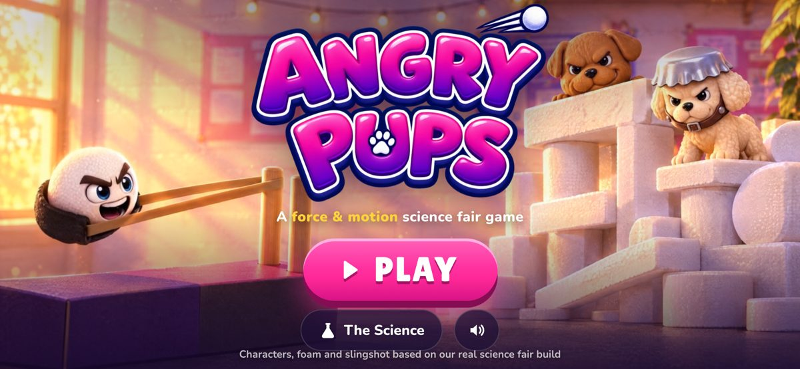
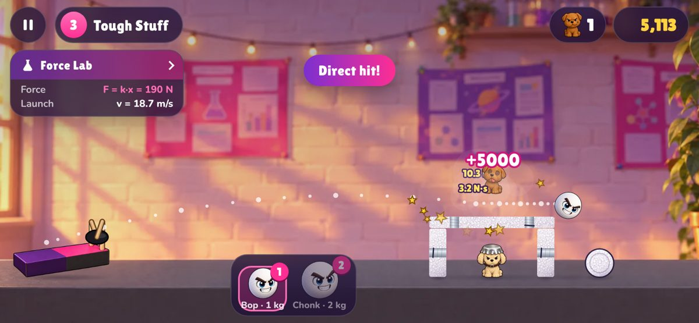
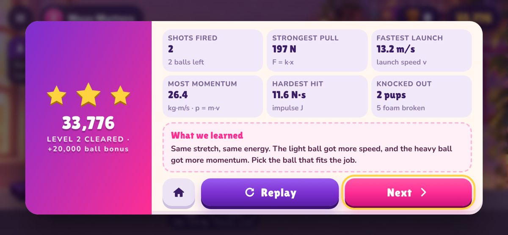
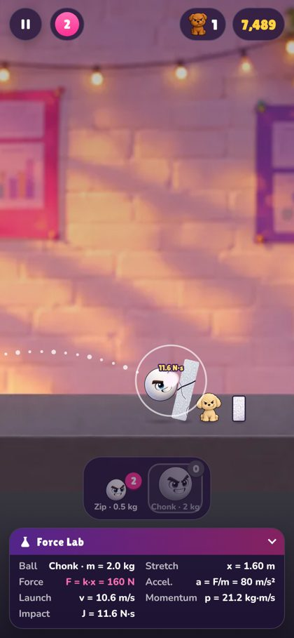
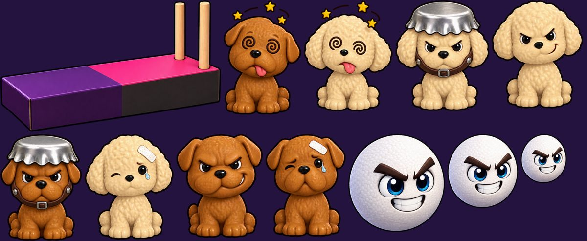

# Angry Pups 🐶 A Force & Motion Science Fair Game

A mobile-first slingshot physics game built for our science fair project about **force**.
The characters, foam and slingshot are all based on our real build: two toy pups
(Biscuit and Marshmallow), white foam balls and foam blocks, and the pink and purple
slingshot box with wooden dowels and rubber bands.



| Gameplay | Lab Report | Portrait |
|---|---|---|
|  |  |  |

## Play it

The game is plain HTML/CSS/JavaScript with no build step.

- **Quickest:** open `index.html` in a browser (works straight from the folder).
- **On a phone over Wi-Fi:** from this folder run `python3 -m http.server 8000`, then open
  `http://<your-computer's-IP>:8000` on the phone.
- **Online:** https://buildingsomethinggreat.github.io/Kids-angrypups/
  Every push redeploys automatically through `.github/workflows/deploy-pages.yml`, which
  first re-runs the physics checks. (One-time setup: **Settings → Pages → Source: GitHub
  Actions**.) Any static host (Netlify, Vercel, Cloudflare Pages) works too.
- On a phone you can **Add to Home Screen** and it opens full-screen like an app.

**How to play:** drag back on the foam ball in the slingshot and let go. Pick a ball
from the tray: **Zip** (small, 0.5 kg), **Bop** (medium, 1 kg) or **Chonk** (large, 2 kg).
Knock out every pup before you run out of balls. Taped foam and pups wearing bottle-cap
helmets need several hits.

## The science (it's real physics)

The game runs a real physics engine ([planck.js](https://github.com/piqnt/planck.js), a
port of Box2D) in SI units: metres, kilograms, seconds and newtons, with gravity
g = 9.8 m/s².

| Idea | Formula | How the game uses it |
|---|---|---|
| Spring force (Hooke's law) | `F = k × x` | The slingshot band is a spring with k = 100 N/m. The band pushes the ball **every physics step** with F = k·x until it passes the rest point. More stretch means more force. |
| Newton's 2nd law | `a = F ÷ m` | The same band force accelerates light Zip twice as much as Bop. |
| Energy → speed | `½kx² = ½mv²` | Every ball gets the same energy from the same pull, so v = x·√(k/m): light balls fly faster. The Force Lab panel shows the predicted speed, then the speed the simulation actually measured. |
| Momentum | `p = m × v` | Heavy Chonk is slower but carries more momentum, so it shoves heavy things around. |
| Impulse | `J = F × Δt` | Damage is the collision impulse read straight from the physics solver (shown as "N·s" on every hit). Foam soaks up the first 1 N·s of each hit, and tough materials need several big impulses. |
| Gravity & torque | `τ = F × d` | Hitting a tall tower high up tips it over, and gravity does the rest. |

Each of the 5 levels teaches one idea:

1. **Stretch It!** Hooke's law
2. **Mass Matters** mass, speed & momentum
3. **Tough Stuff** impulse & repeated force
4. **Topple Tower** gravity & torque
5. **Pup Fortress** put it all together

After each level, the **Lab Report** shows your strongest pull, fastest launch, most
momentum and hardest hit, plus a "What we learned" summary.

*Try it with the real slingshot:* pull the pouch back 5, 10 and 15 cm and measure how far
the foam ball flies. Then try a bigger ball with the same pull. Does it match the game?

## How it was made

- **Art:** generated with [Higgsfield](https://higgsfield.ai), using our photos of the
  pups, foam balls, foam shapes and slingshot as references (GPT Image 2.5 with
  transparent backgrounds). `tools/build_assets.py` slices the sheets into a single
  sprite atlas: 8 pup poses (angry / hurt / knocked-out / helmet × 2 pups), 3 foam
  ball heroes and the slingshot.

  

- **Title video:** two looping cinematic shots (landscape and portrait) animated with
  Kling 3.0 Pro on Higgsfield. Each one starts and ends on the same frame, so the loop
  is seamless.
- **Sound & music:** synthesised live with the Web Audio API (no audio files).
- **Fonts:** Lilita One and Nunito (SIL Open Font License).

## Project layout

```
index.html            screens + HUD markup
css/style.css         mobile-first styles (portrait control deck, landscape HUD)
js/sim.js             physics + rules (no DOM, shared with the Node tests)
js/levels.js          the 5 levels and their science text
js/game.js            renderer, camera, touch input, particles
js/main.js            screens, Force Lab panel, lab reports, saved progress
js/audio.js           Web Audio sound effects and music
js/atlas-data.js      sprite atlas map (generated)
assets/               sprites, backgrounds, logo, title videos, fonts
art/                  original Higgsfield images and the full sprite sheet
tools/                asset build script and automated tests
vendor/planck.min.js  physics engine (MIT)
```

## Tests

```bash
node tools/simtest.js            # every level stands still on its own and can be won
python3 -m http.server 8765 &
node tools/smoke.js              # loads the game on phone and desktop sizes, takes screenshots
node tools/simtest.js --json && node tools/playtest.js   # plays all 5 levels with real drags
```

`simtest.js` runs a "greedy player" through the real physics to prove each level can be
cleared with the balls provided. The browser tests need Playwright.
